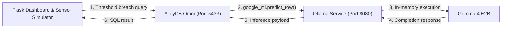

# Gemma 4 and AlloyDB Omni Local Deployment

Official Google Codelab: [Gemma 4 + AlloyDB Omni Codelab](https://codelabs.developers.google.com/gemma-4-alloydb-omni)

---

## A. Project Overview

This project provides a local, air-gapped architecture for running predictive AI inference directly from an operational database.

- **Gemma 4 E2B (`gemma4:e2b`)**: The local open-weights language model responsible for evaluating equipment conditions.
- **AlloyDB Omni**: Google Cloud's PostgreSQL-compatible database deployed in a self-managed container. It provides high-performance storage, query execution, and direct SQL-level integration with machine learning endpoints via the `google_ml_integration` extension. AlloyDB Omni executes the SQL queries and coordinates inference; it is not the language model itself.
- **Ollama**: The local model runtime serving Gemma 4 over an internal HTTP API.
- **Flask Application**: A Python web dashboard simulating a 1500T industrial forging press. It monitors sensor readings, detects threshold breaches, and dispatches SQL queries to AlloyDB Omni.

### Workflow

```
Sensor readings → Threshold detection → Flask → SQL query → AlloyDB Omni → Gemma via Ollama → AI-generated explanation → Dashboard
```

When pressure, temperature, or vibration exceed baseline operating tolerances, the Flask application issues a single SQL query to AlloyDB Omni. AlloyDB Omni invokes the local Gemma 4 model inside the network perimeter using `google_ml.predict_row()`, returning diagnostic insights directly to the dashboard.

---

## B. Architecture



---

## C. Why AlloyDB Omni Instead of Standard PostgreSQL or MySQL?

AlloyDB Omni offers distinct advantages for data and AI workloads:

- **PostgreSQL Compatibility**: Full compatibility with existing PostgreSQL drivers, schemas, extensions, and tools.
- **AlloyDB AI & Model Endpoint Integration**: Direct in-database SQL functions (`google_ml.predict_row`) to invoke local or remote machine learning models without custom middleware.
- **Columnar Engine**: Accelerates analytical and reporting queries alongside transactional operations.
- **Automatic Memory Management & Adaptive Autovacuum**: Reduces operational administration overhead.
- **Air-Gapped & Self-Managed Operation**: Runs entirely on-premises or on local developer workstations without sending sensitive telemetry to public cloud APIs.
- **Unified Operational & AI Queries**: Combines operational database queries with AI inference in a single database transaction.

### Performance Documentation Claims

According to Google's official AlloyDB Omni documentation:
- **More than 2x faster transactional throughput** compared to standard PostgreSQL in Google's performance tests.
- **Up to 100x faster analytical queries** compared to standard PostgreSQL in Google's performance tests.

> Note: The headline "over 4x faster transactional workloads" refers specifically to the fully managed Google Cloud AlloyDB service, not AlloyDB Omni. Real-world performance varies depending on workload characteristics, schema design, and hardware configuration.

References:
- [AlloyDB Omni Overview](https://docs.cloud.google.com/alloydb/omni/docs/overview)
- [AlloyDB Omni Additions to PostgreSQL](https://docs.cloud.google.com/alloydb/omni/docs/additions-to-postgresql)

---

## D. System Requirements

### Software Requirements
- Windows 10/11 with Docker Desktop and WSL2, or Linux (Ubuntu 22.04+) or macOS.
- Git and a shell terminal (PowerShell, Bash, or Zsh).
- Python 3.11 or compatible Python release.
- Python dependencies: `Flask` and `psycopg2-binary`.
- Docker Desktop or Docker Engine.
- Internet connectivity for initial container image pulls and model download. Subsequent inference operates entirely offline.

### Hardware Recommendations
- **RAM**: 16 GB minimum starting point; 32 GB recommended.
- **Disk Space**: At least 25–30 GB free storage for Docker images, containers, and Ollama model weights.
- **Acceleration**: Optional NVIDIA GPU. CPU inference is fully functional but slower.
- If configuring NVIDIA GPU passthrough on Windows Docker Desktop, consult the official WSL2 and GPU guides.

Model weights require several gigabytes and are downloaded inside the container; they are excluded from Git version control.

References:
- [Docker Desktop WSL2 Documentation](https://docs.docker.com/desktop/features/wsl/)
- [Docker Desktop GPU Support](https://docs.docker.com/desktop/features/gpu/)

---

## E. Step 1 — Set Up Gemma 4 Using Ollama

Create a `Dockerfile` at the root of the repository:

```dockerfile
FROM ollama/ollama:latest
ENV OLLAMA_HOST=0.0.0.0:8080
ENV OLLAMA_MODELS=/root/.ollama
ENV MODEL=gemma4:e2b
RUN ollama serve & sleep 5 && ollama pull $MODEL
ENTRYPOINT ["ollama", "serve"]
```

Build the container image:

```bash
docker build -t gemma4-local .
```

Run the container using port publishing on port `8080`:

```bash
docker run -d -p 8080:8080 --name gemma4-ollama-instance gemma4-local
```

Verify that the container is running and the model is loaded:

```bash
docker ps
docker exec -it gemma4-ollama-instance ollama list
curl.exe http://localhost:8080/api/tags
```

Test inference with a short context window and thinking disabled:

```bash
curl.exe -X POST http://localhost:8080/api/generate -H "Content-Type: application/json" -d "{\"model\":\"gemma4:e2b\",\"prompt\":\"Reply only OK\",\"stream\":false,\"think\":false,\"options\":{\"num_ctx\":2048,\"num_predict\":128}}"
```

---

## F. Step 2 — Set Up AlloyDB Omni

Create a persistent volume for database storage:

```bash
docker volume create alloydb-data
```

Start AlloyDB Omni mapping container port `5432` to host port `5433` to prevent conflicts with any native PostgreSQL instance:

```bash
docker run -d --name my-omni -e POSTGRES_PASSWORD=omni -v alloydb-data:/var/lib/postgresql/data -p 5433:5432 gcr.io/alloydb-omni/alloydbomni:18
```

Verify the database status and port mapping:

```bash
docker ps
docker port my-omni
docker exec -it my-omni psql -U postgres -c "SELECT current_database(), current_user;"
```

---

## G. Step 3 — Enable AlloyDB ML Integration

Configure the required ML agent and query engine parameters in `postgresql.conf` without duplicate entries, then restart the database:

```bash
docker exec -it my-omni bash -c "
for param in 'omni_enable_ml_agent_process = on' 'google_ml_integration.enable_model_support = on' 'google_ml_integration.enable_ai_query_engine = on'; do
  key=\$(echo \$param | cut -d' ' -f1)
  grep -q \"^\$key\" /var/lib/postgresql/data/postgresql.conf || echo \"\$param\" >> /var/lib/postgresql/data/postgresql.conf
done
"
docker restart my-omni
```

Connect to the PostgreSQL instance:

```bash
docker exec -it my-omni psql -U postgres
```

Create the ML integration extension:

```sql
CREATE EXTENSION IF NOT EXISTS google_ml_integration CASCADE;
```

---

## H. Step 4 — Connect AlloyDB Omni to Gemma 4

Inside Docker Desktop on Windows, AlloyDB Omni reaches the host-published Ollama port at `http://host.docker.internal:8080/api/generate`.

Register the model inside AlloyDB Omni:

```sql
CALL google_ml.create_model(
    model_id => 'gemma4:e2b',
    model_request_url => 'http://host.docker.internal:8080/api/generate',
    model_provider => 'custom',
    model_type => 'generic'
);
```

Test SQL-driven inference through `google_ml.predict_row`:

```sql
SELECT google_ml.predict_row(
    model_id => 'gemma4:e2b',
    request_body => '{
        "model": "gemma4:e2b",
        "prompt": "Why is the sky blue?",
        "stream": false,
        "think": false,
        "options": {
            "num_ctx": 2048,
            "num_predict": 128
        }
    }'::json
)->>'response' AS answer;
```

If the model is already registered, inspect it with `SELECT * FROM google_ml.model_info_view;` or remove it with `CALL google_ml.drop_model('gemma4:e2b');`.

---

## I. Step 5 — Run the Flask Dashboard

Install dependencies and start the application:

```bash
cd gemma4-alloydb-omni-demo
python -m pip install flask psycopg2-binary
python app.py
```

Open the dashboard in a web browser:

```
http://localhost:5000
```

The application connects to AlloyDB Omni on `127.0.0.1:5433` using the local development password `omni`. Operators can toggle between normal operation and simulated fault injection (overpressure, overheating, excess vibration) to view real-time diagnostics generated by Gemma 4.

---

## J. Troubleshooting

- **Inference killed or Out of Memory (OOM)**: Reduce memory footprint by specifying `"options": {"num_ctx": 2048, "num_predict": 128}` and `"think": false` in the inference payload. Allocate at least 8–12 GB RAM to Docker Desktop.
- **Slow CPU inference**: Ensure prompt size and `num_predict` are constrained. Enable GPU passthrough if an NVIDIA GPU is available.
- **Ollama API unreachable**: Verify that `gemma4-ollama-instance` is active with `docker ps` and port `8080:8080` is published.
- **AlloyDB missing published port**: Ensure container was launched with `-p 5433:5432`. Check with `docker port my-omni`.
- **Database authentication failure**: Ensure the connection password matches `POSTGRES_PASSWORD=omni` configured during container initialization.
- **`google_ml.predict_row()` failure**: Check database logs with `docker logs my-omni`. Confirm that `host.docker.internal:8080` is reachable from within the container.
- **Model registration conflict**: If `google_ml.create_model` reports that the model already exists, inspect existing registrations in `google_ml.model_info_view`.
- **Flask displays AlloyDB offline**: Confirm that container `my-omni` is healthy and listening on host port `5433`.
- **Disk space exhaustion**: Clear dangling images and build cache with `docker system prune -a`.
- **Port 5432 conflict**: This project binds AlloyDB Omni to host port `5433` to prevent collisions with existing PostgreSQL services.

---

## K. Summary of Key Learnings

- Deploying local LLMs using Ollama in containerized environments.
- Operating AlloyDB Omni locally with persistent storage.
- Using `google_ml_integration` and `predict_row` to drive SQL-native inference.
- Implementing telemetry pipelines and simulated fault injection.
- Visualizing diagnostic events in Flask.
- Optimizing context length, prediction tokens, and Docker networking for local hardware constraints.

---

## L. References

- [Google Codelab: Gemma 4 + AlloyDB Omni](https://codelabs.developers.google.com/gemma-4-alloydb-omni)
- [AlloyDB Omni Overview](https://docs.cloud.google.com/alloydb/omni/docs/overview)
- [AlloyDB Omni Additions to PostgreSQL](https://docs.cloud.google.com/alloydb/omni/docs/additions-to-postgresql)
- [AlloyDB Omni Model Endpoint Management](https://cloud.google.com/alloydb/docs/omni/manage-model-endpoints)
- [Docker Desktop WSL2 Documentation](https://docs.docker.com/desktop/features/wsl/)
- [Docker Desktop GPU Support](https://docs.docker.com/desktop/features/gpu/)
- [Upstream Sample Repository](https://github.com/AbiramiSukumaran/gemma4-alloydb-omni-demo)
